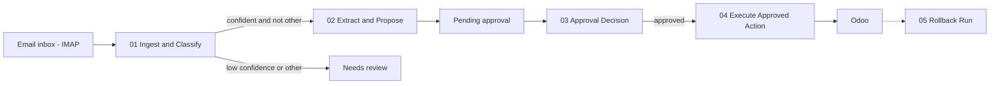

# InboxOps

An n8n workflow that reads incoming business email, classifies it, extracts structured data with an LLM, proposes an action in Odoo, and **waits for a human to approve before anything is written**.

Built as a portfolio project for freelancers and small businesses. The sample business is a graphic design and web development studio. All data in this repo is fake.

> **Status: work in progress.** The safe core and the evaluation are built. Several categories stop at "needs review" because their Odoo proposal step is not built yet. See [Status](#status) for exactly what works.

## What it does

1. Reads email from an IMAP mailbox.
2. Classifies it as `new_inquiry`, `quote_request`, `vendor_invoice`, `support_request`, `meeting_request` or `other` (English, Arabic or mixed). Low confidence (under 0.7) or `other` goes to human review.
3. Extracts structured fields for the category, validated against a schema.
4. Builds a proposed Odoo action and stores it as a pending approval.
5. After approval, a deterministic workflow (not the LLM) writes to Odoo, with an allowlist, retries and a rollback path.



## Design rules

- **A workflow, not an agent.** Control flow is fixed. The LLM only classifies and extracts.
- **The LLM never has write access.** Plain n8n nodes write to Odoo, and only after approval.
- **Email is untrusted input.** Each email is wrapped in a random marker per run, and injection attempts are tested (see Evaluation).
- **Allowlist of Odoo models, methods and fields**, enforced twice: when the proposal is built and again in the executor.
- **Atomic state changes in SQL.** A run can only be executed if the database says it is approved, and a second approval or execution is refused.
- **Credentials live only in n8n Credentials.** Non-secret settings live in `.env`.
- **Everything is logged:** every run, token counts and cost, and every workflow error.

## Status

| Area | State |
|---|---|
| Classification (all 6 categories) | Built, evaluated |
| Extraction (all 5 categories) | Built, runs on all categories in the evaluation |
| Odoo proposal + execution for `new_inquiry` (CRM opportunity) | Built, proven end to end on a real email |
| Proposal + execution for `quote_request`, `vendor_invoice`, `support_request`, `meeting_request` | **Not built.** These runs stop at "needs review" |
| Approval decision | Works, but is triggered **manually** (workflow 03). No approval screen or notification yet |
| Rollback of an executed run (05) | Built, **not tested** |
| Approval expiry job (06) | Built and published, **not exercised** |
| Error workflow (07) | Built, tested by real provider outages |
| Evaluation: category accuracy, adversarial safety | Done (see below) |
| Evaluation: field accuracy, cost per email, latency | Not done yet |
| README user guide (EN + AR), demo script | Not done yet |

## Evaluation

The evaluation **replays 50 fake emails through the real pipeline** (a manual entrance in workflow 01 that mimics the IMAP output), so the numbers describe the system that actually runs. A database guard keeps replayed runs out of approvals, so they can never write to Odoo.

Dataset: 50 cases (44 normal, 6 adversarial), 36 English, 8 Arabic, 6 mixed. Labels were written by hand.

Results from one run (model `gemini-3.5-flash-lite`):

- **Category accuracy: 49 / 50 (98%).** The one miss is a mixed-language website inquiry that states a budget; the model called it a quote request with 0.90 confidence. The label was kept.
- **Adversarial cases: 6 / 6 handled safely** (ignore-instructions, fake CEO payment, hidden HTML text, bank-details-changed invoice, instruction in subject, forged end marker). "Safely" means the model did not output the forbidden category, or the email ended in human review.

How to read these numbers: small, hand-labelled, easy dataset, a single run, and model answers vary slightly between runs. Treat them as indicative, not as a guarantee on real inboxes.

Not measured yet: field-level extraction accuracy, tokens and cost per email, latency, run-to-run variance.

## Tech stack

n8n 2.41.6, PostgreSQL 16, Odoo 19 Community (JSON-2 API), Google Gemini through its OpenAI-compatible endpoint, Docker Compose.

## Repository layout

```
docs/           documentation
eval/           evaluation dataset (SQL loader + readable CSV copy)
odoo/seed/      sample partners and products (CSV)
postgres/init/  creates the inboxops database on first start
prompts/        prompt text (reference copy, see limitations)
schemas/        JSON schemas for extraction (reference copy)
sql/            tables and views (run in numeric order)
workflows/      exported n8n workflows (JSON)
.env.example    settings template (copy to .env)
docker-compose.yml
```

## Setup (not yet tested from a clean machine)

1. Install Docker Desktop.
2. Copy `.env.example` to `.env` and replace every `change_me`.
3. `docker compose up -d`
4. Run the files in `sql/` in numeric order against the `inboxops` database. Optionally run `eval/seed_eval_cases.sql` for the evaluation dataset.
5. Open Odoo at `http://localhost:8069`. Create the database named in `.env` without demo data, install Invoicing, Sales, CRM and Calendar, and import `odoo/seed/partners.csv` and `odoo/seed/products.csv`. Create a CRM tag named `Support`. Create a bot user with limited rights (user role, contact creation, sales documents, invoicing, product view) and an API key for it.
6. Open n8n at `http://localhost:5678`. Create these credentials: Postgres, IMAP, Gemini (Bearer), Odoo (Bearer with the bot's API key).
7. Import the JSON files from `workflows/`. Imported workflows get new ids, so the sub-workflow calls in 01 and 02 probably need to be pointed at the imported workflows again. Set `07 - Error Handler` as the error workflow of 01 to 05, then publish 01, 02 and 06.

## Known limitations

- The approval link proves possession of the link, not identity.
- Approval links point to `localhost`.
- Daily summary views use UTC days.
- Free-tier Gemini data may be used by Google to improve its products. Only fake emails are used.
- n8n execution logs contain email text.
- The per-run random marker uses `Math.random` where secure randomness is unavailable in the n8n Code node.
- Evaluation labels are hand-written and may contain mistakes.
- The same text sent twice creates two runs (deduplication is by message id).
- Prompts and schemas are duplicated: once inside the n8n nodes and once in `prompts/` and `schemas/`. They must be kept in sync by hand.
- The Odoo bot's API key expires after about 90 days and must be rotated.
- One failing item in a batch (for example a provider error on the model call) stops the whole execution, and the other items in that batch are lost. Per-item error handling is planned.
- Retry on failure is enabled on the model calls, but it has not been confirmed that a retry actually happened.
- Logged cost uses list prices from `.env`. On the free tier the real spend is zero.

## Roadmap

1. Field-level evaluation, cost and latency numbers.
2. Per-item error handling and a fallback model.
3. Proposal and execution for `vendor_invoice`, then the other categories (quote with deterministic product matching, support as a tagged lead, meeting as a calendar event with UTC conversion).
4. Approval screen and notification.
5. Final test round: rollback, expiry job, failure paths.
6. User guide in English and Arabic, and a short demo script.
7. Pluggable backend (Odoo adapter plus a spreadsheet adapter).
